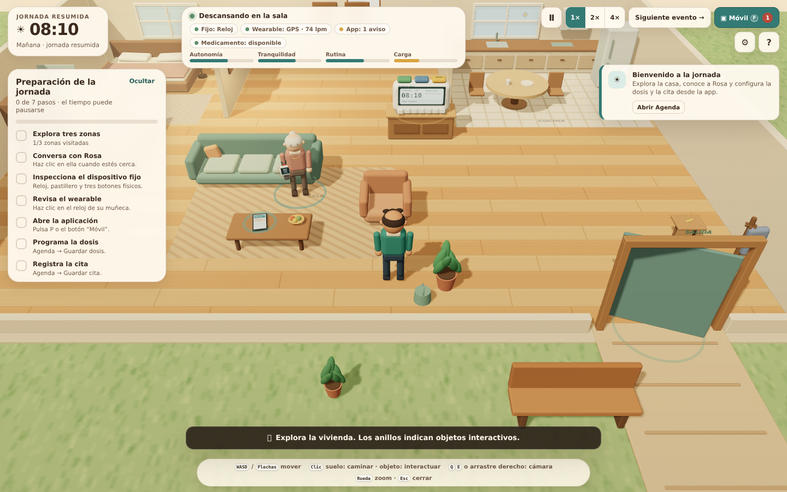

# Cuida·Día — Un día acompañando a Rosa

Simulador 3D jugable, inmersivo e interactivo sobre cuidado y autonomía del adulto mayor. El jugador asume el papel de **Álex**, cuidador de **Rosa**, y recorre una jornada resumida en una vivienda explorable mientras una aplicación móvil, un dispositivo fijo y un wearable colaboran mediante eventos simulados.



La imagen de referencia del proyecto se conserva en [`docs/referencia-dispositivos.png`](docs/referencia-dispositivos.png). Los modelos 3D, texturas, personajes y sonidos de esta implementación son procedurales y propias de la demo; no se reutilizan recursos de otros videojuegos.

---

## 1. Decisión de plataforma

El repositorio estaba vacío y no definía una plataforma de desarrollo. Se eligió **Three.js + Vite + JavaScript modular en el navegador** porque:

- permite una escena 3D realmente explorable sin instalar un editor externo;
- funciona directamente en la vista previa web de Arena;
- admite modelos, cámaras, animaciones, materiales e interacción por raycasting;
- facilita simular la comunicación entre dispositivos con un bus de eventos interno;
- mantiene la entrega ligera: no hay assets externos, servidores backend ni hardware real.

La experiencia usa WebGL, Web Audio y, cuando el navegador la ofrece, síntesis de voz integrada. Todos los avisos de voz incluyen subtítulos.

---

## 2. Ejecución

```bash
npm install
npm run dev
```

Abre la URL local o la vista previa de Arena. Para generar y servir una versión de producción:

```bash
npm run build
npm run preview
```

Requisitos: Node.js 20+ y un navegador con WebGL habilitado.

---

## 3. Controles

| Acción | Control |
| --- | --- |
| Mover al cuidador | `WASD`, flechas o joystick táctil |
| Caminar hasta un punto | Clic izquierdo en el suelo |
| Interactuar con objeto | Clic en un objeto con anillo |
| Rotar cámara | `Q` / `E`, arrastre con botón derecho o arrastre táctil |
| Zoom | Rueda del ratón |
| Abrir/cerrar aplicación móvil | `P` o botón **Móvil** |
| Pausar/reanudar jornada | `Espacio` o botón de pausa |
| Cerrar panel | `Esc` |
| Ayuda | `H` o botón `?` |

En pantallas táctiles aparece un joystick virtual. Las decisiones pausan automáticamente el tiempo y no tienen límite de duración.

---

## 4. Cómo jugar

1. **Introducción.** Conoce a Rosa: maestra jubilada, aficionada a sus plantas y con preferencias claras sobre cómo recibir ayuda.
2. **Preparación.** Explora tres zonas, conversa con Rosa, inspecciona el dispositivo fijo y el wearable, abre la app y programa una dosis y una cita desde **Agenda**.
3. **Jornada.** Usa **Siguiente evento** o deja avanzar el tiempo simulado. La rutina incluye desayuno, medicación, preparación de una cita, un momento de autonomía, reposición de medicamento y una alerta SOS simulada.
4. **Decisiones.** Cada acontecimiento ofrece respuestas con consecuencias narrativas sobre autonomía, tranquilidad, continuidad de la rutina y carga del cuidador. No hay una única respuesta correcta.
5. **Cierre.** A las 18:00 se muestra un resumen con decisiones, efectos, recomendaciones y el alcance técnico de la demo. Después puedes seguir explorando libremente.

---

## 5. Flujos interactivos implementados

### Flujo de medicamentos

La app mantiene explícitamente separados estos estados:

1. **Dosis programada** — se registra desde la aplicación.
2. **Aviso enviado** — el reloj emite aviso visual, sonoro y por voz.
3. **Compartimento abierto** — la tapa 3D se desliza y muestra la pastilla.
4. **Interacción completada** — Rosa retira la pastilla; el compartimento se cierra y la app recibe el evento.
5. **Toma confirmada por Rosa** — solo se registra cuando Rosa lo manifiesta en una conversación. Es una confirmación autodeclarada, **no** una detección de ingesta.

Retirar una pastilla nunca se interpreta automáticamente como ingerirla.

### Flujo de citas médicas

- La cita se registra desde la app y se refleja en el calendario 3D y en el dispositivo fijo.
- El reloj anuncia la cita por voz y permite consultarla con su botón azul.
- El jugador prepara la salida mediante una decisión narrativa.
- Una opción habilita una lista interactiva en la app: documento, chaqueta y llaves.
- La puerta permite acompañar a Rosa hasta la salida; la cita se representa de forma resumida.

### Flujo de emergencia

- Rosa pulsa el botón SOS del wearable, o el jugador puede simular la pulsación.
- La app recibe una alerta visible con ubicación GPS simulada.
- Se pueden consultar el mapa GPS, el pulso, la concentración de oxígeno y una señal simulada de posible caída.
- Las respuestas disponibles son: acudir y hablar, activar un contacto de emergencia simulado o llamar a Rosa desde la app de forma simulada.
- **No se envían llamadas, mensajes ni solicitudes reales.**

### Flujo de reposición

- El botón ámbar del dispositivo fijo comunica que un medicamento se ha agotado.
- La app permite marcar la reposición como **pendiente** o **completada**.
- El botiquín 3D permite representar la acción física de reponer.
- El estado del medicamento se sincroniza entre app, reloj y wearable.

### Signos vitales y wearable

Además de mostrar la hora, el wearable:

- registra lecturas simuladas de **pulso** y **concentración de oxígeno (SpO₂)**;
- mantiene un historial y una gráfica en la pestaña **Salud**;
- muestra una señal simulada de posible caída, tomada de la imagen de referencia;
- ofrece un botón SOS rojo funcional dentro de la simulación.

Los valores son de demostración y no constituyen información médica ni un diagnóstico.

---

## 6. Sincronización interna

No hay dispositivos físicos conectados. La comunicación se simula con un bus de eventos interno (`src/state.js`, `src/game.js`). Algunos eventos principales son:

- `dose:scheduled`, `dose:status`
- `appointment:scheduled`, `appointment:status`
- `device:announce`
- `wearable:vitals`, `wearable:sos`
- `medication:status`
- `emergency:resolved`
- `notification:new`

La pestaña **Sistema** de la app muestra un registro legible de sincronización. El reloj 3D, la pantalla del wearable, la app y el calendario se actualizan a partir del mismo estado.

---

## 7. Accesibilidad

- Controles de teclado, ratón y táctiles.
- Velocidad de tiempo 1× / 2× / 4× y pausa manual.
- Las decisiones detienen el tiempo.
- Subtítulos siempre visibles para los avisos de voz.
- Ajustes funcionales de voz, texto ampliado, alto contraste y reducción de movimiento.
- Indicadores de estado con texto además de color.
- Interfaz responsive y navegación por teclado con foco visible.
- Notificaciones con `aria-live` y paneles con `role="dialog"`.

---

## 8. Alcance: implementado, simulado y pendiente

| Estado | Contenido |
| --- | --- |
| **Implementado** | Vivienda 3D explorable; cámara orbital; personajes procedurales animados; objetos interactivos; sistema de tiempo; rutina diaria; decisiones narrativas; app móvil con cinco secciones; agenda; pastillero animado; tres botones físicos del reloj; wearable con hora, SOS, GPS, pulso y O₂; mapa interno; registro de sincronización; resumen final. |
| **Simulado** | Comunicación entre dispositivos mediante eventos internos; voz con síntesis del navegador; ubicación GPS dentro del plano de la casa; lecturas de pulso y concentración de oxígeno; posible caída; respuestas de emergencia; citas y salidas. Ninguna acción usa hardware, servicios de emergencia, llamadas ni mensajes reales. |
| **Pendiente** | Integración con hardware físico, validación clínica de signos vitales, servicios reales de respuesta a emergencias, persistencia de partidas y un catálogo más amplio de medicamentos, citas y escenas. |

Todos los controles visibles tienen una acción implementada; no se presentan botones decorativos como funcionalidades.

---

## 9. Estructura del proyecto

```text
.
├── index.html                 # Estructura de HUD, app móvil y paneles
├── src/
│   ├── main.js                # Arranque WebGL y bucle principal
│   ├── state.js               # Estado global y bus de eventos
│   ├── game.js                # Director de juego, flujos y narrativa
│   ├── world.js               # Vivienda, objetos 3D y dispositivos
│   ├── characters.js          # Personajes procedurales y animaciones
│   ├── controls.js            # Movimiento, cámara, raycasting y táctil
│   ├── ui.js                  # HUD, app, decisiones, ajustes y resumen
│   ├── audio.js               # Avisos sonoros y síntesis de voz
│   └── style.css              # Diseño visual y accesibilidad
├── docs/
│   ├── captura-juego.png
│   └── referencia-dispositivos.png
├── package.json
└── vite.config.js
```

---

## 10. Verificación

- `npm run build` completa correctamente.
- Se ejecutó una prueba automatizada en navegador headless con WebGL que recorrió: introducción, agenda, dosis, confirmación conversacional, cita, lista de salida, reposición, GPS, signos vitales, alerta SOS, ajustes de accesibilidad y resumen final, sin errores de consola ni de página.
- La demo prioriza una primera versión funcional antes que contenido secundario; la jornada está comprimida para que pueda completarse en pocos minutos.
